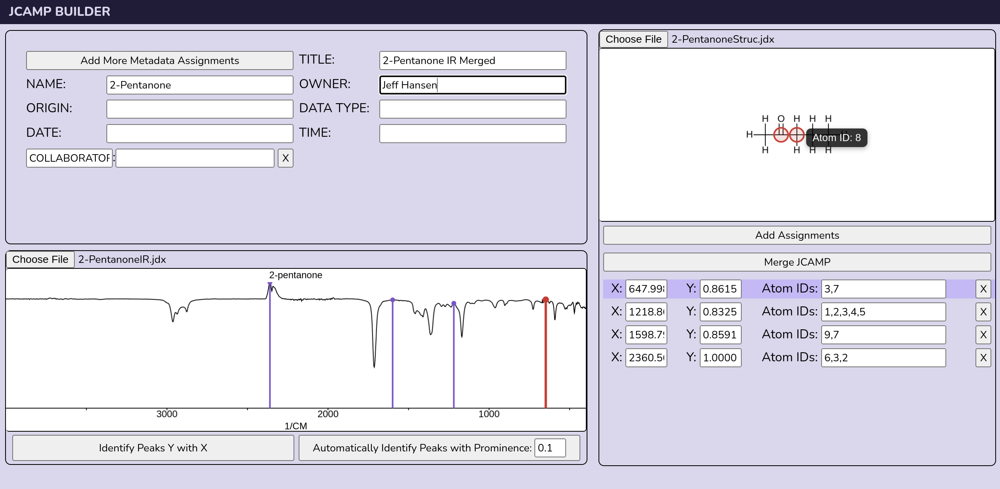
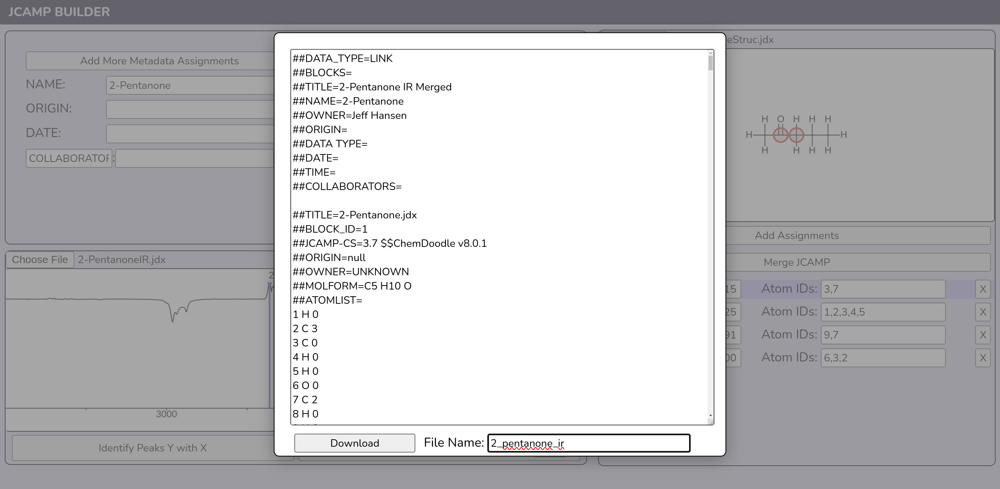

# JCAMP-DX Builder

A web-based editor for assigning spectral peaks to atoms and combining spectral and molecular structure data into JCAMP-DX files compatible with applications using ChemDoodle's JCAMPInterpreter.makeStructureSpectrumSet() function.





## Local setup

### Requirements

- A modern web browser
- Python 3 or another local HTTP server

### Running the project

```bash
git clone https://github.com/biochem-learning/jcamp-builder-app.git
cd spectrum-app-v2
python3 -m http.server 8000
```

On Windows, use:

```powershell
py -m http.server 8000
```

Open the applications in your browser: <http://localhost:8000>

## Acknoledgement

This project uses [ChemDoodle Web Components](https://web.chemdoodle.com/) by iChemLabs, licensed under GPLv3.
